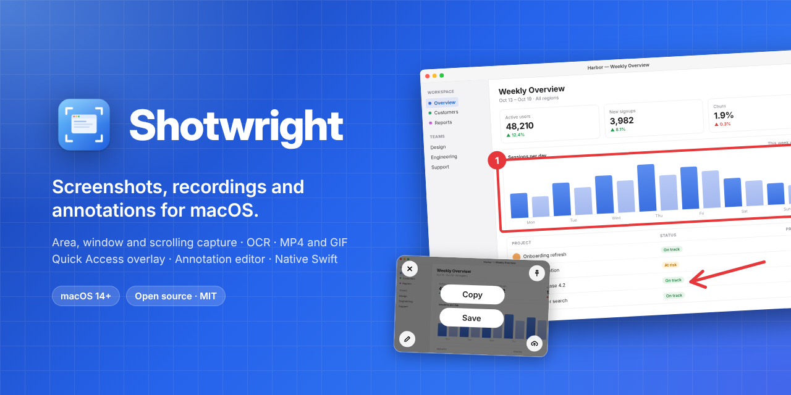
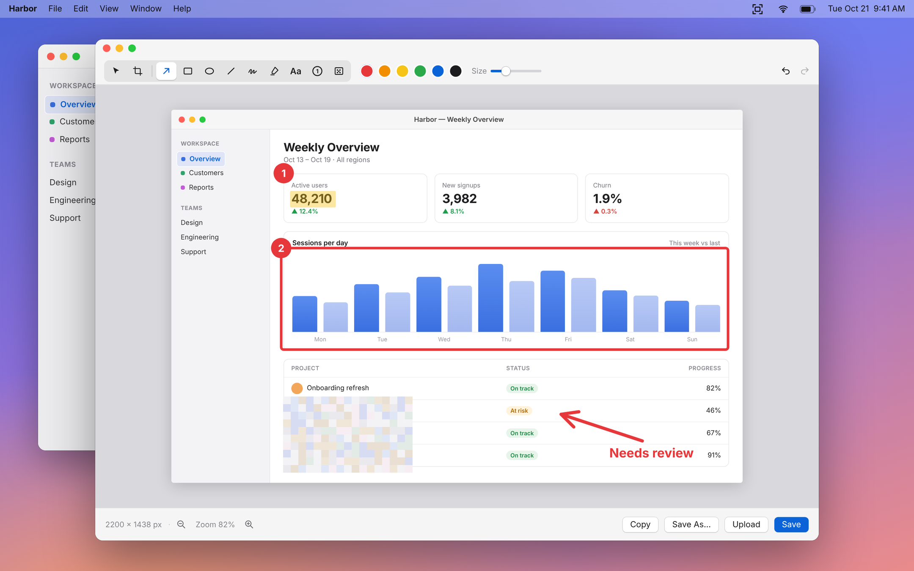
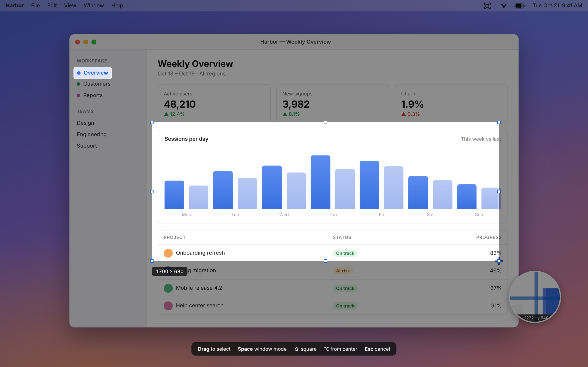
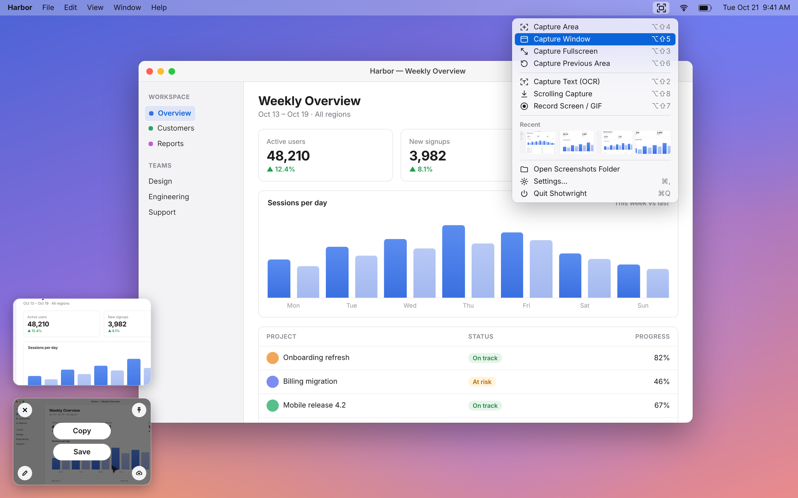
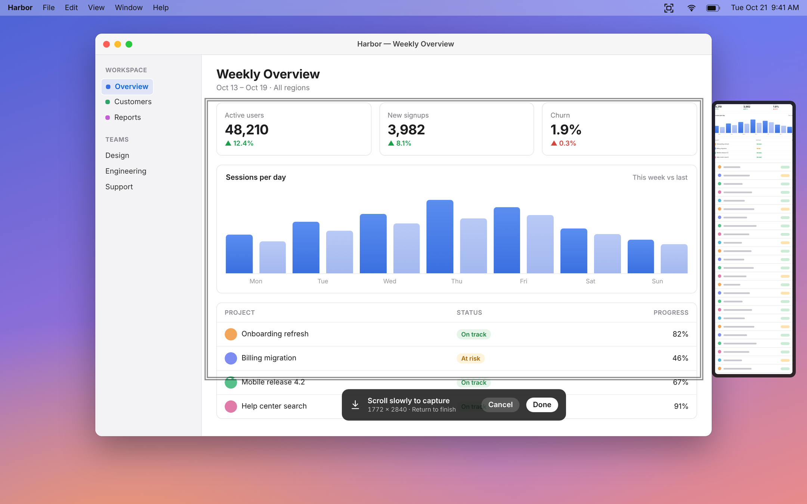
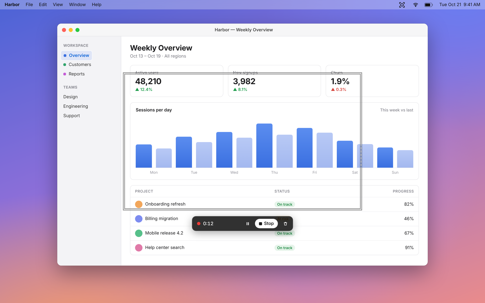

<p align="center">
  
</p>

<p align="center">
  <b>A native macOS screenshot app in the spirit of CleanShot X.</b><br>
  Capture an area, a window or a whole scrolling page, record the screen as MP4 or GIF,<br>
  mark it up, and drop it straight into whatever you're working on.
</p>

<p align="center">
  
  
  <a href="LICENSE"></a>
</p>

Shotwright lives in the menu bar. Press a shortcut, pick what to capture, and the result pops up as a thumbnail in the corner of the screen: copy it, save it, drag it into Slack or a pull request, pin it above your windows, or open it in the editor to add arrows, boxes, numbered steps and blur. Everything runs on your Mac. There is no account, no tracking, and text recognition happens on-device.

## Screenshots

<p align="center">
  
  <br><sub>The annotation editor: arrows, shapes, text, numbered counters, highlighter and pixelate.</sub>
</p>

<table>
  <tr>
    <td width="50%"><br><sub><b>Capture Area</b> on a frozen screen, with a pixel loupe and size badge.</sub></td>
    <td width="50%"><br><sub><b>Menu bar and Quick Access</b>: every action one click away, captures stacked bottom-left.</sub></td>
  </tr>
  <tr>
    <td width="50%"><br><sub><b>Scrolling Capture</b> stitches a long page into one image, with a live preview.</sub></td>
    <td width="50%"><br><sub><b>Record Screen / GIF</b> with a floating bar that never shows up in the video.</sub></td>
  </tr>
</table>

## Features

**Capture**
- **Area**: the screen freezes while you drag, with a magnifier loupe, live size badge, <kbd>⇧</kbd> for a square and <kbd>⌥</kbd> to grow from the center.
- **Window**: hover a window and click. Captures it cleanly even when other windows overlap it. <kbd>Space</kbd> switches between area and window mode.
- **Fullscreen** and **Previous Area** (repeat the last region in one keystroke).
- **Capture Text (OCR)**: select any part of the screen and the recognised text goes to the clipboard, using Apple's on-device Vision framework.
- **Scrolling Capture**: select an area or window, then scroll. Frames are stitched into one tall image, keeping sticky headers and footers only once. A live preview sits beside the area; <kbd>Return</kbd> finishes, <kbd>Esc</kbd> cancels.

**Record**
- **Screen recording as MP4 or GIF**: drag an area, click for the full screen, or press <kbd>Space</kbd> for a window. A small bar picks the format and whether to show the cursor, then turns into a timer with Pause, Stop and Discard. The bar and border are excluded from the recording.
- Finished recordings land in Quick Access, ready to copy (the file, or GIF data), save, play or drag into any app.

**After the capture**
- **Quick Access overlay**: thumbnails stack in the bottom-left corner. Hover for Copy, Save, Close, Pin and Annotate; double-click to annotate; drag a thumbnail into any app; right-click for more.
- **Pin to screen**: float a capture above every window. Drag to move, scroll to resize, double-click or <kbd>Esc</kbd> to close.
- **Annotation editor**: select and move, crop, arrow, rectangle, ellipse, line, pen, highlighter, text, numbered counters and pixelate. Six colours, adjustable size, undo and redo, zoom, then Copy, Save or Save As (PNG, JPEG or HEIC).

**Everyday comfort**
- A menu bar menu with every action, its shortcut, and your four most recent captures.
- Settings for the save folder, file format (PNG, JPEG, HEIC), Retina (@2x) export, what happens after a capture (Quick Access, copy, auto-save), shutter sound, start at login and including the cursor.
- No Dock icon. Shotwright only appears in the Dock while an editor window is open.

## Keyboard shortcuts

| Action | Shortcut |
|---|---|
| Capture Area | <kbd>⌥</kbd> <kbd>⇧</kbd> <kbd>4</kbd> |
| Capture Window | <kbd>⌥</kbd> <kbd>⇧</kbd> <kbd>5</kbd> |
| Capture Fullscreen | <kbd>⌥</kbd> <kbd>⇧</kbd> <kbd>3</kbd> |
| Capture Previous Area | <kbd>⌥</kbd> <kbd>⇧</kbd> <kbd>6</kbd> |
| Capture Text (OCR) | <kbd>⌥</kbd> <kbd>⇧</kbd> <kbd>2</kbd> |
| Record Screen / GIF (press again to stop) | <kbd>⌥</kbd> <kbd>⇧</kbd> <kbd>7</kbd> |
| Scrolling Capture | <kbd>⌥</kbd> <kbd>⇧</kbd> <kbd>8</kbd> |

They use <kbd>⌥</kbd><kbd>⇧</kbd> so they don't clash with macOS's own <kbd>⌘</kbd><kbd>⇧</kbd><kbd>3</kbd>/<kbd>4</kbd>/<kbd>5</kbd>.

While selecting: <kbd>Space</kbd> toggles area and window mode, <kbd>⇧</kbd> locks a square, <kbd>⌥</kbd> draws from the center, <kbd>Esc</kbd> cancels. In the editor: <kbd>⌘C</kbd> copy, <kbd>⌘S</kbd> save, <kbd>⇧⌘S</kbd> save as, <kbd>⌘Z</kbd> / <kbd>⇧⌘Z</kbd> undo and redo, <kbd>⌘=</kbd> / <kbd>⌘-</kbd> / <kbd>⌘0</kbd> zoom, <kbd>⌫</kbd> deletes the selected mark.

## Install

Shotwright needs **macOS 14 Sonoma or later**.

- **Direct download**: signed and notarized DMGs will be published on the [Releases](https://github.com/chiranjeebhub/Shotwright/releases) page. That build updates itself with [Sparkle](https://sparkle-project.org).
- **Mac App Store**: a sandboxed build is being prepared for the App Store.
- **From source**: see below. This is the way to run it today.

## Permissions

Shotwright asks for one permission:

- **Screen & System Audio Recording**, which macOS requires for any app that captures the screen. On first launch macOS shows its prompt; turn Shotwright on in *System Settings › Privacy & Security › Screen & System Audio Recording*, then quit and reopen Shotwright.

It does not need Accessibility access: the global shortcuts use the Carbon hot key API, which works without it. Nothing leaves your Mac; text recognition runs on-device.

If macOS keeps asking even though the switch is on, remove Shotwright from that list with the − button, add it again and reopen it. This happens when the app's code signature changes, for example with unsigned local builds (see below).

## Build from source

You need Xcode 15 or later and [XcodeGen](https://github.com/yonaskolb/XcodeGen). The Xcode project is generated from `project.yml`, so there is no `.xcodeproj` in the repo.

```sh
git clone https://github.com/chiranjeebhub/Shotwright.git
cd Shotwright
brew install xcodegen
xcodegen generate
open Shotwright.xcodeproj
```

In Xcode, choose your team under *Signing & Capabilities* (a free personal team works) and press <kbd>⌘R</kbd>.

To build, sign, install to `/Applications` and relaunch in one step:

```sh
scripts/install.sh
```

It signs with your Apple Development certificate, or a self-signed "Shotwright Local Signing" certificate it creates once. Prefer this to running an unsigned build: macOS ties the Screen Recording permission to the code signature, and an unsigned build gets a new signature on every rebuild, so macOS would ask again each time.

Command-line build:

```sh
xcodegen generate
xcodebuild -project Shotwright.xcodeproj -scheme Shotwright -configuration Debug build
```

Built with Swift, SwiftUI and AppKit, ScreenCaptureKit, AVFoundation, Vision and Core Image.

## Code layout

```
Shotwright/
  App/        App entry, menu bar dropdown, CaptureCoordinator (routes every capture)
  Capture/    Capture model and ScreenCaptureKit wrapper
  Overlay/    Area/window selection overlay, Quick Access thumbnails, pinned images
  Recording/  Screen recorder (SCStream + AVAssetWriter), GIF export, recording bar and result card
  Editor/     Annotation model, renderer, editor model/view/window
  ScrollingCapture/  Scrolling capture session, HUD and frame stitcher
  Services/   Hotkeys (Carbon), permissions, settings, clipboard, export, OCR, sound, toast
  Settings/   Settings window
```

Built with Swift, SwiftUI + AppKit, ScreenCaptureKit (`SCScreenshotManager`), Vision and Core Image.

## Roadmap

- Audio (microphone and system audio) in recordings
- Auto-scroll for scrolling capture
- Cloud upload with share links
- Custom keyboard shortcuts
- A capture history window

Ideas and bug reports are welcome in [Issues](https://github.com/chiranjeebhub/Shotwright/issues).

## Releasing (maintainers)

`project.yml` defines two builds of the same app (bundle ID `com.shotwright.app`):

| Scheme | For | Differences |
|---|---|---|
| `Shotwright` | Direct download (DMG) and `scripts/install.sh` | Not sandboxed, updates itself with [Sparkle](https://sparkle-project.org) |
| `Shotwright-AppStore` | Mac App Store | App Sandbox, no Sparkle |

In the sandboxed build the first save asks which folder to use (Desktop preselected) and remembers it as a security-scoped bookmark.

Both need a paid Apple Developer Program team; pass its Team ID as `SHOTWRIGHT_TEAM_ID`. Bump `MARKETING_VERSION` in `project.yml` for each release; the build number is the UTC time of the archive.

### Direct download

```sh
SHOTWRIGHT_TEAM_ID=XXXXXXXXXX scripts/release-direct.sh
```

Archives with your Developer ID Application certificate, notarizes and staples the app and the DMG, writes `dist/Shotwright-<version>.dmg`, and adds an entry to `appcast.xml`. Publish by attaching the DMG to a GitHub release tagged `v<version>` and pushing `appcast.xml`; installed copies read the feed from `main`.

One-time setup: a Developer ID Application certificate (Xcode > Settings > Accounts > Manage Certificates), notarization credentials (`xcrun notarytool store-credentials shotwright-notary --apple-id <you> --team-id <team>`), and a Sparkle key (`generate_keys` from the Sparkle package; the public key goes in `SPARKLE_PUBLIC_KEY` in `project.yml`, the private key stays in your keychain).

### Mac App Store

```sh
SHOTWRIGHT_TEAM_ID=XXXXXXXXXX scripts/release-appstore.sh            # export build/AppStore/Shotwright.pkg
SHOTWRIGHT_TEAM_ID=XXXXXXXXXX scripts/release-appstore.sh --upload   # upload to App Store Connect
```

Needs the App Store Connect app record for `com.shotwright.app`.

## License

Shotwright is released under the [MIT License](LICENSE). It is an independent project and is not affiliated with CleanShot X or its makers.
